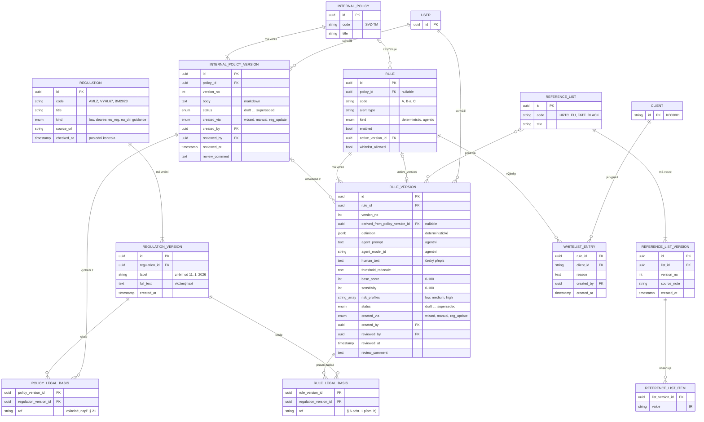

# Datový model: regulace, interní předpisy, pravidla

- **Verze:** 0.3, 2026-10-19
- **Rozsah:** regulace, interní předpisy, pravidla, referenční seznamy, whitelist. Klient, transakce, vyhodnocení, AML události a audit log sem nepatří. Model zpřesňuje [sekci 3 specifikace](spec.md#3-doménový-model).
- **Cíl:** MVP pro demo na hackathonu. Model je záměrně jednoduchý. Co chybí kvůli reálnému nasazení, uvádí [sekce Compliance poznámky](#compliance-poznámky).

## Diagram

Stav verze (`status`) u předpisu i pravidla nabývá hodnot `draft`, `pending_review`, `approved`, `rejected`, `superseded`.

## Rozhodnutí

| # | Rozhodnutí | Důvod |
| --- | --- | --- |
| M1 | Regulace má **znění** (`REGULATION_VERSION`). Nové znění je nový řádek s vloženým textem. | Tlačítko „zkontrolovat aktualizace“ potřebuje poznat, která pravidla stojí na starém znění. |
| M2 | Ustanovení (paragrafy) **nejsou** samostatná entita. Odkaz na paragraf je text v poli `ref`. | Jednoduchost MVP. |
| M3 | Předpis a regulace mají vazbu **M:N** přes `POLICY_LEGAL_BASIS`. Vazba je nepovinná. | Jeden předpis vychází z více regulací. Existuje i čistě interní předpis. Mění D1. |
| M4 | Pravidlo **může** patřit pod předpis (`policy_id` je nullable). | Ruční pravidlo nemusí mít předpis. |
| M5 | Každá verze pravidla má vlastní právní základ (`RULE_LEGAL_BASIS`) s odkazem na znění regulace. Odkazy se nedědí z předpisu. | Pravidlo stojí obvykle na 1–3 paragrafech, ne na všech regulacích předpisu. |
| M6 | Pravidlo drží `enabled` a `active_version_id`. Verze drží `status`. Dokud nová verze čeká na schválení, spouští se `active_version_id`. | Řeší otázku 4 ve spec. Stavy z D10 se v UI odvodí: `update_for_review` = pravidlo má aktivní verzi a novější verzi v `pending_review`. |
| M7 | `sensitivity`, `risk_profiles` a `base_score` jsou ve verzi. Jejich změna vytvoří novou verzi. Zapnutí a vypnutí verzi nevytváří. | Změna citlivosti mění detekci, proto musí projít schválením. |
| M8 | Interní předpis je **jeden markdown text** na verzi, bez článků. | Jednoduchost MVP. |
| M9 | Referenční seznamy (HRTC EU, FATF black list, interní rizikové země) mají verze. Seznamy **nemají** schvalování. Vyhodnocení použije **poslední verzi**. | Pravidlo B na seznamech závisí. Jednoduchost MVP. |
| M10 | Katalog featur je **jen v kódu**. Z něj se generuje JSON schema pro Bedrock a slovník pro český přepis. | Featury píše vývojář a reviewují se v PR. |
| M11 | Schválení jsou **pole na verzi** předpisu a pravidla (`reviewed_by`, `reviewed_at`, `review_comment`). Jiné entity schválení nemají. | Jednoduchost MVP. |
| M12 | MVP má **jednu roli `admin`**. Systém nekontroluje 4-eyes. | Demo obslouží jeden uživatel. |
| M13 | Verze agentního pravidla drží `agent_prompt` a `agent_model_id`. Vstup, výstup a vyrenderovaný prompt LLM ukládá **vyhodnocení pravidla**. | Vyhodnocení musí jít zpětně rekonstruovat. |
| M14 | `definition` obsahuje jen logiku pravidla: `match`, `features` a `conditions`. Skóre a citlivost jsou sloupce. | Sloupce jdou filtrovat a zobrazit v UI bez parsování JSON. |
| M15 | Risk profily jsou `low`, `medium`, `high` podle sloupce `AML risk score` v datech klientů. | Data neobsahují neznámý profil. Mění D12. |
| M16 | Whitelist je dvojice pravidlo × klient s povinným `reason`. Odebrání záznam smaže a zapíše do audit logu. `whitelist_allowed = false` whitelist u pravidla zakáže. | Jednoduchost MVP. Pravidla B jsou regulatorně povinná. |
| M17 | Verze předpisu a pravidla jsou neměnné. Systém je nemaže. | Rekonstruovatelnost rozhodnutí (vyhláška 67/2018 § 18). |

## Aktualizace regulace

1. Uživatel vloží nový text regulace. Systém vytvoří nové `REGULATION_VERSION`.
2. Systém najde verze pravidel a předpisů, které přes `*_LEGAL_BASIS` odkazují na předchozí znění.
3. Pro každé dotčené pravidlo systém vytvoří novou verzi s `created_via = regulation_update` a stavem `pending_review`. Nová verze odkazuje na nové znění.

## Compliance poznámky

Před reálným nasazením je musí zkontrolovat compliance officer nebo právník:

- **Whitelist bez schválení.** Benchmark ČNB 2/2023 (kap. III.ii) vyžaduje u whitelistu odůvodnění, schválení a pravidelnou revizi.
- **Referenční seznamy bez schválení.** Změna seznamu rizikových zemí mění detekci pravidla B.
- **Jedna role bez 4-eyes.** Reálný provoz potřebuje oddělené role a zákaz schválit vlastní návrh.
- **Chybí periodická revize pravidel** (vyhláška 67/2018 § 4 odst. 4–6).
- **Poslední verze seznamu** při ex post vyhodnocení nemusí odpovídat seznamu platnému k datu transakce.
