# Datový model

- **Verze:** 0.4, 2026-10-19
- **Rozsah:** regulace, interní předpisy, pravidla, referenční seznamy, whitelist, nahrání CSV s transakcemi, vyhodnocovací běh, výsledky pravidel a trace až k regulaci. Model zpřesňuje [sekce 3 a 5 specifikace](spec.md#3-doménový-model).
- **Mimo rozsah:** AML události, triage (`FP` / `REVIEW`), eskalace, lidské review, export povinného CSV a audit log. MVP končí zobrazením výsledku běhu.
- **Cíl:** MVP pro demo na hackathonu. Model je záměrně jednoduchý. Co chybí kvůli reálnému nasazení, uvádí [sekce Compliance poznámky](#compliance-poznámky).

## Konvence

- Tabulky v databázi jsou `snake_case` v množném čísle, stejně jako existující `clients` a `transactions`. Diagram používá jednotné číslo.
- `CLIENT` a `TRANSACTION` už existují (baseline migrace v `golden`). Diagram uvádí jen sloupce, na které model odkazuje.
- `USER` má jednu nebo více rolí ([M12](#rozhodnutí-pravidla)). Přihlášení ani kontrola oprávnění v MVP nejsou.
- Výčtové hodnoty (`enum`) jsou v databázi `text` s `check` omezením, stejně jako u existujících tabulek.

## Diagram

```mermaid
erDiagram
    REGULATION ||--|{ REGULATION_VERSION : "má znění"
    REGULATION_VERSION ||--o{ POLICY_LEGAL_BASIS : "cituje"
    INTERNAL_POLICY_VERSION ||--o{ POLICY_LEGAL_BASIS : "vychází z"
    INTERNAL_POLICY ||--|{ INTERNAL_POLICY_VERSION : "má verze"
    INTERNAL_POLICY |o--o{ RULE : "zastřešuje"
    INTERNAL_POLICY_VERSION |o--o{ RULE_VERSION : "odvozena z"
    RULE ||--|{ RULE_VERSION : "má verze"
    RULE |o--o| RULE_VERSION : "active_version"
    RULE_VERSION ||--o{ RULE_LEGAL_BASIS : "právní základ"
    REGULATION_VERSION ||--o{ RULE_LEGAL_BASIS : "cituje"
    REFERENCE_LIST ||--|{ REFERENCE_LIST_VERSION : "má verze"
    REFERENCE_LIST_VERSION ||--o{ REFERENCE_LIST_ITEM : "obsahuje"
    REFERENCE_LIST }o--o{ RULE_VERSION : "používá"
    RULE ||--o{ WHITELIST_ENTRY : "výjimky"
    CLIENT ||--o{ WHITELIST_ENTRY : "je vyjmut"
    USER ||--o{ RULE_VERSION : "schválil"
    USER ||--o{ INTERNAL_POLICY_VERSION : "schválil"
    USER ||--o{ EVALUATION_RUN : "spustil"
    EVALUATION_RUN ||--o{ RUN_RULE_VERSION : "fixuje pravidla"
    RULE_VERSION ||--o{ RUN_RULE_VERSION : "je v běhu"
    EVALUATION_RUN ||--o{ RUN_REFERENCE_LIST_VERSION : "fixuje seznamy"
    REFERENCE_LIST_VERSION ||--o{ RUN_REFERENCE_LIST_VERSION : "je v běhu"
    EVALUATION_RUN ||--o{ TRANSACTION_EVALUATION : "obsahuje"
    TRANSACTION ||--o{ TRANSACTION_EVALUATION : "je vyhodnocena v"
    CLIENT ||--o{ TRANSACTION : "provádí"
    TRANSACTION_EVALUATION ||--|{ RULE_EVALUATION : "obsahuje"
    RULE_VERSION ||--o{ RULE_EVALUATION : "je spuštěna v"
    FX_RATE }o--o{ RULE_EVALUATION : "kurz je v features"

    REGULATION {
        uuid id PK
        string code "AMLZ, VYHL67, BM2023"
        string title
        enum kind "law, decree, eu_reg, eu_dir, guidance"
        string source_url
        timestamp checked_at "poslední kontrola"
    }
    REGULATION_VERSION {
        uuid id PK
        uuid regulation_id FK
        string label "znění od 11. 1. 2026"
        text full_text "vložený text"
        timestamp created_at
    }
    POLICY_LEGAL_BASIS {
        uuid policy_version_id FK
        uuid regulation_version_id FK
        string ref "volitelné, např. § 21"
    }
    INTERNAL_POLICY {
        uuid id PK
        string code "SVZ-TM"
        string title
    }
    INTERNAL_POLICY_VERSION {
        uuid id PK
        uuid policy_id FK
        int version_no
        text body "markdown"
        enum status "draft … superseded"
        enum created_via "wizard, manual, reg_update"
        uuid created_by FK
        uuid reviewed_by FK
        timestamp reviewed_at
        text review_comment
    }
    RULE {
        uuid id PK
        uuid policy_id FK "nullable"
        string code "A, B-a, C"
        string alert_type
        enum kind "deterministic, agentic"
        bool enabled
        uuid active_version_id FK
        bool whitelist_allowed
    }
    RULE_VERSION {
        uuid id PK
        uuid rule_id FK
        int version_no
        uuid derived_from_policy_version_id FK "nullable"
        jsonb definition "deterministické"
        text agent_prompt "agentní"
        string agent_model_id "agentní"
        text human_text "český přepis"
        string escalation_role "na koho se eskaluje, výchozí contact_person"
        text threshold_rationale
        int base_score "0-100"
        int sensitivity "0-100"
        string_array risk_profiles "low, medium, high"
        enum status "draft … superseded"
        enum created_via "wizard, manual, reg_update"
        uuid created_by FK
        uuid reviewed_by FK
        timestamp reviewed_at
        text review_comment
    }
    RULE_LEGAL_BASIS {
        uuid rule_version_id FK
        uuid regulation_version_id FK
        string ref "§ 6 odst. 1 písm. b)"
    }
    REFERENCE_LIST {
        uuid id PK
        string code "HRTC_EU, FATF_BLACK"
        string title
    }
    REFERENCE_LIST_VERSION {
        uuid id PK
        uuid list_id FK
        int version_no
        string source_note
        timestamp created_at
    }
    REFERENCE_LIST_ITEM {
        uuid list_version_id FK
        string value "IR"
    }
    WHITELIST_ENTRY {
        uuid rule_id FK
        string client_id FK
        text reason
        uuid created_by FK
        timestamp created_at
    }
    EVALUATION_RUN {
        uuid id PK
        enum status "importing, running, completed, failed"
        string file_name
        string file_sha256
        int rows_total
        int rows_imported
        int rows_rejected
        jsonb import_errors "max. 1000 řádků"
        int hit_threshold "0-100, výchozí 50"
        string engine_version "git commit"
        int tx_processed "průběh"
        int tx_passed
        int tx_flagged
        int tx_error
        uuid created_by FK
        timestamp created_at
        timestamp finished_at
        text error_message
    }
    RUN_RULE_VERSION {
        uuid run_id FK
        uuid rule_version_id FK
    }
    RUN_REFERENCE_LIST_VERSION {
        uuid run_id FK
        uuid list_version_id FK
    }
    TRANSACTION_EVALUATION {
        uuid id PK
        uuid run_id FK
        string transaction_id FK
        string client_id FK "denormalizace"
        int source_row_no "řádek v CSV"
        string client_risk_profile "snapshot"
        enum verdict "pass, flagged, error"
        int max_score "0-100"
        int hit_count
        timestamp evaluated_at
    }
    RULE_EVALUATION {
        uuid id PK
        uuid transaction_evaluation_id FK
        uuid rule_version_id FK
        enum outcome "pass, hit, not_applicable, error"
        enum skip_reason "whitelist, risk_profile"
        int raw_score "0-100"
        int adjusted_score "po citlivosti"
        jsonb features "vstupní hodnoty"
        jsonb trace "vyhodnocené podmínky"
        string_array context_refs "ID transakcí"
        text llm_prompt "agentní"
        jsonb llm_response "agentní"
        string llm_model_id "agentní"
        text error_message
    }
    FX_RATE {
        string currency PK
        date rate_date PK
        numeric czk_per_unit
        string source "CNB"
    }
    TRANSACTION {
        string transaction_id PK "TX000000001"
        string client_id FK
    }
    CLIENT {
        string client_id PK "K000001"
        string aml_risk_score "low, medium, high"
    }
    USER {
        uuid id PK
        string_array roles "compliance_analyst … designated_person"
    }
```



Stav verze (`status`) u předpisu i pravidla nabývá hodnot `draft`, `pending_review`, `approved`, `rejected`, `superseded`.

Unikátní klíče: `TRANSACTION_EVALUATION (run_id, transaction_id)`, `RULE_EVALUATION (transaction_evaluation_id, rule_version_id)`.

## Část A: pravidla

### Rozhodnutí: pravidla

| # | Rozhodnutí | Důvod |
| --- | --- | --- |
| M1 | Regulace má **znění** (`REGULATION_VERSION`). Nové znění je nový řádek s vloženým textem. | Tlačítko „zkontrolovat aktualizace“ potřebuje poznat, která pravidla stojí na starém znění. |
| M2 | Ustanovení (paragrafy) **nejsou** samostatná entita. Odkaz na paragraf je text v poli `ref`. | Jednoduchost MVP. |
| M3 | Předpis a regulace mají vazbu **M:N** přes `POLICY_LEGAL_BASIS`. Vazba je nepovinná. | Jeden předpis vychází z více regulací. Existuje i čistě interní předpis. Mění D1. |
| M4 | Pravidlo **může** patřit pod předpis (`policy_id` je nullable). | Ruční pravidlo nemusí mít předpis. |
| M5 | Každá verze pravidla má vlastní právní základ (`RULE_LEGAL_BASIS`) s odkazem na znění regulace. Odkazy se nedědí z předpisu. | Pravidlo stojí obvykle na 1–3 paragrafech, ne na všech regulacích předpisu. |
| M6 | Pravidlo drží `enabled` a `active_version_id`. Verze drží `status`. Dokud nová verze čeká na schválení, spouští se `active_version_id`. | Řeší otázku 4 ve spec. Stavy z D10 se v UI odvodí: `update_for_review` = pravidlo má aktivní verzi a novější verzi v `pending_review`. |
| M7 | `sensitivity`, `risk_profiles` a `base_score` jsou ve verzi. Jejich změna vytvoří novou verzi. Zapnutí a vypnutí verzi nevytváří. | Změna citlivosti mění detekci, proto musí projít schválením. |
| M8 | Interní předpis je **jeden markdown text** na verzi, bez článků. | Jednoduchost MVP. |
| M9 | Referenční seznamy (HRTC EU, FATF black list, interní rizikové země) mají verze. Seznamy **nemají** schvalování. Vyhodnocení použije **poslední verzi**. | Pravidlo B na seznamech závisí. Jednoduchost MVP. |
| M10 | Katalog featur je **jen v kódu**. Z něj se generuje JSON schema pro Bedrock a slovník pro český přepis. | Featury píše vývojář a reviewují se v PR. |
| M11 | Schválení jsou **pole na verzi** předpisu a pravidla (`reviewed_by`, `reviewed_at`, `review_comment`). Jiné entity schválení nemají. | Jednoduchost MVP. |
| M12 | Uživatel má **jednu nebo více rolí**: `compliance_analyst`, `compliance_officer`, `lawyer`, `contact_person` (AML zákon § 22), `designated_person` (§ 22a). Backend role nekontroluje, aktivní roli volí web. Systém nekontroluje 4-eyes. | Issue #6. Přihlášení je mimo rozsah hackathonu. |
| M13 | Verze agentního pravidla drží `agent_prompt` a `agent_model_id`. Vstup, výstup a vyrenderovaný prompt LLM ukládá **vyhodnocení pravidla**. | Vyhodnocení musí jít zpětně rekonstruovat. |
| M14 | `definition` obsahuje jen logiku pravidla: `match`, `features` a `conditions`. Skóre a citlivost jsou sloupce. | Sloupce jdou filtrovat a zobrazit v UI bez parsování JSON. |
| M15 | Risk profily jsou `low`, `medium`, `high` podle sloupce `AML risk score` v datech klientů. | Data neobsahují neznámý profil. Mění D12. |
| M16 | Whitelist je dvojice pravidlo × klient s povinným `reason`. Odebrání záznam smaže a zapíše do audit logu. `whitelist_allowed = false` whitelist u pravidla zakáže. | Jednoduchost MVP. Pravidla B jsou regulatorně povinná. |
| M17 | Verze předpisu a pravidla jsou neměnné. Systém je nemaže. **Návrh změny (2026-10-19, čeká na potvrzení týmu):** verze pravidla ve stavu `draft` jde upravit na místě (`PATCH`). Od `pending_review` je neměnná. Každá úprava draftu se zapíše do audit logu a původní návrh AI zůstane dohledatelný. | Rekonstruovatelnost rozhodnutí (vyhláška 67/2018 § 18). Draft ještě nikdo nereviewoval a nespouští se, takže jeho úprava rozhodnutí nemění. |
| M18 | Role, na kterou se eskalují zásahy pravidla (`escalation_role`), je **na verzi pravidla**, výchozí `contact_person`. Mění se novou verzí nebo při review; je to jediné pole verze, které review smí změnit. Výsledky běhu se filtrují podle role verze pravidla, která je v běhu. | Issue #6. Eskalace mění, kdo zásah uvidí, proto prochází review jako citlivost (M7) a starý běh zůstává rekonstruovatelný. |

### Aktualizace regulace

1. Uživatel vloží nový text regulace. Systém vytvoří nové `REGULATION_VERSION`.
2. Systém najde verze pravidel a předpisů, které přes `*_LEGAL_BASIS` odkazují na předchozí znění.
3. Pro každé dotčené pravidlo systém vytvoří novou verzi s `created_via = reg_update` a stavem `pending_review`. Nová verze odkazuje na nové znění.

## Část B: vyhodnocovací běh

### Tok

1. Uživatel nahraje CSV s transakcemi ve formátu `datasets/transactions.csv`.
2. Systém založí `EVALUATION_RUN` ve stavu `importing`. Řádky CSV vloží do tabulky `transactions`. Vadné řádky odmítne a zapíše do `import_errors`.
3. Systém zafixuje sadu pravidel: aktivní verze zapnutých pravidel (`RUN_RULE_VERSION`) a poslední verze referenčních seznamů (`RUN_REFERENCE_LIST_VERSION`).
4. Systém přepne běh do stavu `running`. Pro každou importovanou transakci vytvoří `TRANSACTION_EVALUATION` a pro každou zafixovanou verzi pravidla `RULE_EVALUATION`.
5. Systém přepne běh do stavu `completed` a uloží souhrnné počty.
6. Uživatel vidí souhrn běhu, seznam transakcí s výsledkem a detail transakce s výsledky pravidel, trace a právním základem.

### Výsledek pravidla a transakce

| `outcome` | Význam | Skóre |
| --- | --- | --- |
| `pass` | Pravidlo prošlo. `adjusted_score < hit_threshold`. | vyplněné |
| `hit` | Pravidlo neprošlo. `adjusted_score >= hit_threshold`. | vyplněné |
| `not_applicable` | Pravidlo se nespustilo. Důvod je v `skip_reason`. | prázdné |
| `error` | Vyhodnocení selhalo. Důvod je v `error_message`. | prázdné |

- `adjusted_score = raw_score × sensitivity / 100`. Hodnota `sensitivity` je ve verzi pravidla.
- Deterministické pravidlo vrátí `raw_score = base_score`, když platí podmínky z `definition`. Jinak vrátí 0.
- Agentní pravidlo vrátí `raw_score` z výstupu LLM.

| `verdict` | Podmínka |
| --- | --- |
| `flagged` | Aspoň jedno pravidlo má `outcome = hit`. |
| `error` | Žádné pravidlo nemá `hit` a aspoň jedno má `error`. |
| `pass` | Ostatní případy. |

`max_score` je maximum `adjusted_score` přes pravidla transakce.

### Trace

Každý `RULE_EVALUATION` s `outcome` `pass` nebo `hit` musí obsahovat `features` a `trace`. Trace musí stačit k vysvětlení výsledku bez opětovného výpočtu.

Příklad pro pravidlo A, podmínka (c):

```json
{
  "features": {
    "amount_czk": 74250.00,
    "fx": { "currency": "EUR", "rate_date": "2026-07-01", "czk_per_unit": 24.75 },
    "q2_max_tx_czk": 30356.79
  },
  "trace": {
    "logic": "any",
    "conditions": [
      {
        "id": "c",
        "label": "Jednotlivá transakce > 2× maximální transakce za 2Q2026",
        "left": { "feature": "amount_czk", "value": 74250.00 },
        "op": ">",
        "right": { "expr": "2 × q2_max_tx_czk", "value": 60713.58 },
        "result": true
      }
    ],
    "matched": true,
    "summary": "Transakce 74 250 CZK přesáhla dvojnásobek maximální transakce za 2Q2026 (60 714 CZK)."
  },
  "context_refs": ["TX000000004"]
}
```

U agentního pravidla obsahuje `trace` strukturovaný výstup LLM: `reasoning` a `cited_data`. `llm_prompt` obsahuje vyrenderovaný prompt, `llm_response` surovou odpověď (viz [M13](#rozhodnutí-pravidla)).

#### Cesta k regulaci

Odpověď na otázku „proč transakce neprošla“ vrací jeden dotaz:

```sql
-- Proč transakce neprošla: zasažená pravidla, trace a právní základ
select rv.human_text,
       re.adjusted_score,
       re.trace ->> 'summary' as summary,
       r.code                 as regulation,
       rgv.label              as regulation_version,
       rlb.ref                as provision
from transaction_evaluations te
join rule_evaluations re on re.transaction_evaluation_id = te.id
join rule_versions rv on rv.id = re.rule_version_id
join rule_legal_bases rlb on rlb.rule_version_id = rv.id
join regulation_versions rgv on rgv.id = rlb.regulation_version_id
join regulations r on r.id = rgv.regulation_id
where te.run_id = :run_id
  and te.transaction_id = :transaction_id
  and re.outcome = 'hit';
```

Cesta pokračuje přes `rule_versions.derived_from_policy_version_id` na verzi interního předpisu. Všechny entity na cestě jsou neměnné ([M17](#rozhodnutí-pravidla)), proto cesta platí i zpětně.

### Rozhodnutí: vyhodnocení

| # | Rozhodnutí | Důvod |
| --- | --- | --- |
| V1 | Uživatel nahrává jen **transakce**. Klienti už jsou v databázi. Řádek s neznámým klientem systém odmítne. | Klienti jsou v `golden`. Jednoduchost MVP. |
| V2 | Řádky CSV jdou do tabulky `transactions`. Existující `transaction_id` se stejným obsahem systém znovu použije. Existující `transaction_id` s jiným obsahem systém odmítne. | Transakce jsou neměnné. Stejné CSV jde vyhodnotit znovu s jinými pravidly. |
| V3 | Samotný soubor CSV systém neukládá. Běh drží `file_name`, `file_sha256` a `source_row_no`. | Data zůstávají v databázi. Hash prokáže, který soubor se vyhodnotil. |
| V4 | Běh vyhodnotí **jen transakce z nahraného CSV**. Kontext (historie klienta) tvoří všechny transakce klienta v databázi v okamžiku běhu. | Odpovídá D6. |
| V5 | Běh **fixuje** verze pravidel (`RUN_RULE_VERSION`) a referenčních seznamů (`RUN_REFERENCE_LIST_VERSION`) při startu. Změna pravidla během běhu výsledek neovlivní. | Rekonstruovatelnost. M9 říká „poslední verze“, běh ale musí vědět, kterou použil. |
| V6 | `RULE_EVALUATION` vzniká pro **každou** dvojici transakce × verze pravidla, i pro `not_applicable`. Zúženo ve [V16](#rozhodnutí-vyhodnocení): `pass` se neukládá. | UI ukáže u každé transakce všechna pravidla. Whitelist se při odebrání maže (M16), důvod přeskočení proto musí být v záznamu. |
| V7 | Hranice `hit` je **`hit_threshold` na běhu**, výchozí 50. Skóre transakce je **maximum** skóre pravidel. | Řeší otázky 7 a 8 ve spec pro MVP. Maximum je vysvětlitelné jedním pravidlem. |
| V8 | `features` ukládá vstupní hodnoty včetně použitého kurzu. `context_refs` ukládá ID transakcí, ze kterých pravidlo počítalo. U `pass` může být `context_refs` prázdné. | Trace je čitelný bez přepočtu. Plný seznam u `pass` by zbytečně zvětšil data (~400 000 transakcí × počet pravidel). |
| V9 | `client_risk_profile` je snapshot na `TRANSACTION_EVALUATION`. | Risk profil rozhoduje o `not_applicable`. |
| V10 | `engine_version` (git commit) je na běhu. | Výpočet featur je v kódu (M10). Bez verze kódu nejde výsledek reprodukovat. |
| V11 | Převod do CZK používá `FX_RATE`: kurz ČNB k datu transakce. Tabulku plní migrace. | Dataset obsahuje 23 měn. Řeší FX část otázky 13 ve spec. |
| V12 | Souhrnné počty (`tx_passed`, `tx_flagged`, `tx_error`) a `tx_processed` jsou sloupce běhu. Počty per pravidlo UI počítá dotazem. | Dashboard ukazuje průběh bez agregace 400 000 řádků. |
| V13 | AML událost **nevzniká**. Výsledek běhu je `TRANSACTION_EVALUATION.verdict`. | Lidské review je mimo rozsah. Agregaci do událostí per klient (pravidla A, C) řeší otázka 5 ve spec. |
| V14 | Běh a jeho výsledky jsou neměnné. Systém je nemaže. | Záznam vyhodnocení slouží jako audit log vyhodnocení (spec 7.7). |
| V15 | Běh může místo CSV vyhodnotit **transakce, které už jsou v databázi**. Rozsah určuje `scope` na běhu (`from`, `to`, `clientIds`, `limit`; prázdný = všechny). `file_name` popisuje rozsah, `file_sha256` je hash seřazených ID vyhodnocených transakcí, `source_row_no` je pořadí transakce v běhu. | Data jsou v DB, upload CSV zatím není (#3). Hash prokáže, které transakce se vyhodnotily. |
| V16 | `RULE_EVALUATION` se ukládá jen pro výsledek **jiný než `pass`** (`hit`, `error`, `not_applicable`). `TRANSACTION_EVALUATION` se ukládá pro každou transakci. Zužuje V6. | Celý dataset × 17 pravidel = ~7 mil. řádků. R-01 sám zasáhne ~55 % transakcí. Zajímá nás hlavně, co neprošlo. |
| V17 | Běh se spouští asynchronně: `POST /api/evaluation-runs` vrátí `202` s během ve stavu `running`, výpočet běží mimo request. Lokálně v procesu API, v AWS v samostatné Lambda funkci (`EVALUATION_WORKER_FUNCTION`). | Lambda Web Function může prostředí po odpovědi kdykoli zrušit. Celý dataset trvá lokálně ~45 s, na Auroře déle. |

### Obrazovky

| Obrazovka | Zdroj dat |
| --- | --- |
| Seznam běhů | `EVALUATION_RUN`: stav, soubor, čas, počty `pass` / `flagged` / `error`. |
| Souhrn běhu | Počty transakcí podle `verdict`. Počet `hit` per pravidlo. Odmítnuté řádky z `import_errors`. Zafixované verze pravidel a seznamů. |
| Seznam transakcí běhu | `TRANSACTION_EVALUATION` s filtrem podle `verdict` a pravidla, řazení podle `max_score`. |
| Detail transakce | Transakce, klient, všechna pravidla s `outcome`, skóre, `trace.summary`, podmínkami, právním základem a odkazem na předpis. |

## Compliance poznámky

Před reálným nasazením je musí zkontrolovat compliance officer nebo právník:

### Pravidla

- **Whitelist bez schválení.** Benchmark ČNB 2/2023 (kap. III.ii) vyžaduje u whitelistu odůvodnění, schválení a pravidelnou revizi.
- **Referenční seznamy bez schválení.** Změna seznamu rizikových zemí mění detekci pravidla B.
- **Role bez přihlášení a bez 4-eyes.** Role volí web a backend je nekontroluje. Reálný provoz potřebuje přihlášení, kontrolu oprávnění a zákaz schválit vlastní návrh. Mapování rolí na AML zákon a výchozí eskalace na kontaktní osobu musí posoudit compliance.
- **Chybí periodická revize pravidel** (vyhláška 67/2018 § 4 odst. 4–6).
- **Poslední verze seznamu** při ex post vyhodnocení nemusí odpovídat seznamu platnému k datu transakce.

### Vyhodnocení

- **`hit_threshold` na běhu** mění výsledek detekce. Uživatel ho může zvýšit a potlačit zásahy. Reálný provoz potřebuje schválenou hodnotu, ne volbu při spuštění.
- **Citlivost pod 100** sníží `adjusted_score` a může z `hit` udělat `pass`. Viz [compliance poznámky ve spec](spec.md#11-compliance-poznámky).
- **`verdict = pass` není AML rozhodnutí.** Je to podklad. Transakce s `error` musí jít k člověku.
- **Historie klienta** závisí na tom, co je v databázi v okamžiku běhu. Dva běhy nad stejným CSV mohou dát jiný výsledek, pokud mezi nimi přibyly transakce. `context_refs` u zásahu to zdokumentuje, u `pass` ne.
- **Kurz ČNB k datu transakce** je náš předpoklad. Instituce může mít jiný interní kurz.
- **`pass` bez záznamu pravidla (V16).** U transakce s `verdict = pass` nejde z databáze ukázat trace jednotlivých pravidel. Rekonstrukce vyžaduje nový běh se stejným `engine_version` a stejnými daty.
- **Whitelist běhu** se čte při startu výpočtu, ne při založení běhu. Zachycený je jen jako `not_applicable` se `skip_reason = whitelist`.
- **`base_score` ukázkových pravidel** (seed R-01 až R-17) je `50 + základ priority / 2` podle tabulky P v SVZ-03 a čl. 5–15 SVZ-06. Každá shoda je tak se citlivostí 100 zásah, pořadí priorit zůstává. Modifikátory priority (risk profil, PEP, …) engine nepočítá.
- **Agentní pravidlo nad celým datasetem** znamená stovky tisíc volání LLM. Pro demo je potřeba omezit CSV nebo spouštět agentní pravidlo jen po deterministickém zásahu.
