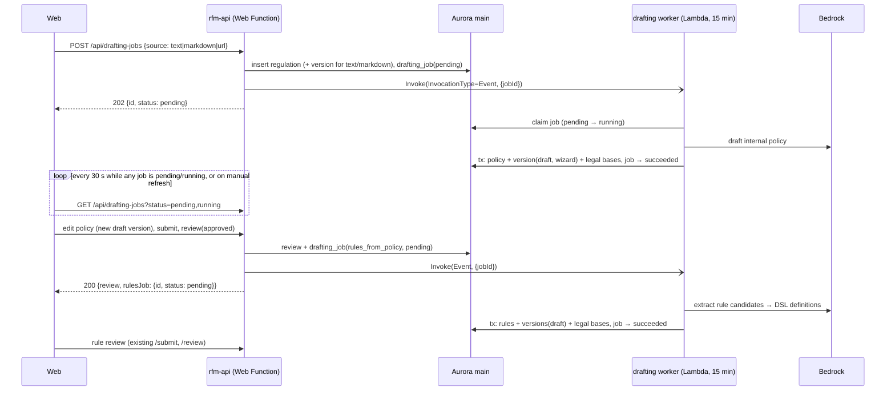

# Drafting jobs: regulation → policy draft → rule drafts (návrh)

Status: **návrh**, not yet agreed by the team. Extends [spec.md §4.2, §7.2](spec.md) and [datovy-model.md](datovy-model.md). Replaces the synchronous BE-02/BE-03 contract in `src/web/backend-todo.md`.

## Related issues

- **#1** (regulation → policy drafts) and **#2** (policy approval → rule drafts): this design is the async plumbing both need. Jiri's Bedrock code (`draftInternalPolicy.ts`, `extractRuleCandidates.ts`) is the LLM half; the worker calls it.
- **#2** asks what happens when generation fails after the approval is written. Here: the approval and the `rules_from_policy` job are inserted in one transaction, a failure ends as a `failed` job, and `POST /api/drafting-jobs/:id/retry` regenerates.
- **#1** keeps `POST /api/regulations/:regulationId/versions/:versionId/draft-policies` as the entry point. Here it becomes an alias that returns `202` with a job (see [API](#api)).
- **#3** (evaluation engine, Filip, `67806b0`): out of scope, but it already solved the same problem for evaluation runs: `EvaluationRunLauncher` port, `InProcessEvaluationRunLauncher` / `LambdaEvaluationRunLauncher`, worker entry point `evaluationWorker.ts`, composition in `evaluationRunComposition.ts`, `EVALUATION_WORKER_FUNCTION`. The drafting worker below copies that pattern and its names.

## Problem

Both LLM steps are too slow for a synchronous HTTP request. A full policy draft is 10–12k output tokens on Opus, non-streaming (`BedrockInternalPolicyDrafter`), i.e. minutes. Today:

- `POST /api/regulations/:id/versions/:versionId/draft-policies` and the approve branch of `POST /api/internal-policies/:id/versions/:vid/review` call the generator inline (Filip's stub, `DummyDraftGenerator`).
- Jiri's Bedrock drafter and rule extractor run only from the CLI.
- Radek's live wizard (`3f62af6`, `src/web/features/wizard/api/live.ts`) creates the regulation and its version through the existing endpoints, then calls `draft-policies` and expects `InternalPolicyVersion[]` in the response. Switching that endpoint to `202` is a breaking change for `liveWizardService.draftPolicies`; agree it with Radek.
- A Lambda Web Function freezes once it has responded, so "respond, then keep working" in the API process is not reliable.

## Flow



Human gates (policy approval, rule approval) stay on the **versions** (M11, `versionStatus.ts`). A job only tracks the machine step. No version is ever activated by a job (spec §11).

## Data model: `drafting_jobs`

One row per LLM step. New migration, generated against a `wip_<name>`.

| Column | Type | Notes |
| --- | --- | --- |
| `id` | uuid PK | |
| `kind` | text CHECK | `policy_from_regulation`, `rules_from_policy` |
| `status` | text CHECK | `pending`, `running`, `succeeded`, `failed` |
| `parent_job_id` | uuid FK NULL | rules job → the policy job it continues, so the web can show one request end to end |
| `source_kind` | text NULL CHECK | `text`, `markdown`, `url`; only for `policy_from_regulation` |
| `source_url` | text NULL | |
| `scope` | text NULL | optional heading to narrow the regulation (`draftInternalPolicyFromRegulation`) |
| `regulation_version_id` | uuid FK NULL | set at insert for text/markdown, by the worker after fetching a URL |
| `policy_version_id` | uuid FK NULL | output of `policy_from_regulation`, input of `rules_from_policy` |
| `output` | jsonb NULL | e.g. `{ruleVersionIds, unverifiedQuotes, openQuestions}` |
| `error_code`, `error_message` | text NULL | set when `failed` |
| `model_id`, `input_tokens`, `output_tokens` | text / int NULL | audit and cost; vyhláška 67/2018 § 18 reconstruction |
| `attempts` | int DEFAULT 0 | |
| `created_by` | uuid FK users | |
| `created_at`, `started_at`, `finished_at` | timestamptz | |

Indexes: `(status, created_at)`, `(parent_job_id)`, `(policy_version_id)`.

The raw regulation text lives in `regulation_versions.full_text` (M1), not on the job. The job and the worker payload carry only ids, which keeps the async invoke payload far below Lambda's limit.

### Status transitions

`pending → running → succeeded | failed`. Nothing else.

- **Claim**: `update drafting_jobs set status='running', started_at=now(), attempts=attempts+1 where id=$1 and status='pending' returning *`. Zero rows → another delivery already has it; exit. Covers Lambda's at-least-once async delivery.
- **Finish**: outputs and `status='succeeded'` in **one transaction** (Filip's `draftPolicies`/`draftRules` loops are not transactional today; a half-written set of rules would otherwise look finished).
- **Stale running**: the list query reports a `running` job with `started_at < now() - 16 min` as `failed` / `timed_out` (lazy; no sweeper). The worker's own timeout is 15 min.
- **Retry**: `POST /api/drafting-jobs/:id/retry` on a `failed` job inserts a **new** job with the same inputs. Jobs are not rerun in place, so each attempt keeps its own error and token usage. Lambda's built-in async retries are set to 0.

## API

All under `/api/drafting-jobs`. Same 202 + polling pattern as BE-01 evaluation runs.

```http
POST /api/drafting-jobs
Content-Type: application/json

{
  "source": { "kind": "text" | "markdown", "content": "…" }
          | { "kind": "url", "url": "https://…" },
  "regulation": { "id": "<uuid>" } | { "code": "…", "title": "…", "kind": "law|decree|eu_reg|eu_dir|guidance" },
  "scope": "Hlava III" | null,
  "createdBy": "<uuid>"
}
```

`202 Accepted`, `Location: /api/drafting-jobs/:id`, body = `DraftingJobDto` with `status: "pending"`.

- A `.md` file is read in the browser and sent as `markdown`. No multipart; PDF stays out of scope (spec §9).
- Validation errors (`400` with `issues`) happen synchronously, before any job exists.

```http
GET /api/drafting-jobs?status=pending,running&kind=policy_from_regulation&regulationId=…&policyId=…&limit=…&cursor=…
GET /api/drafting-jobs/:id
POST /api/drafting-jobs/:id/retry
```

`DraftingJobDto`:

```json
{
  "id": "…",
  "kind": "policy_from_regulation",
  "status": "succeeded",
  "parentJobId": null,
  "regulation": { "id": "…", "code": "…", "title": "…", "versionId": "…" },
  "policy": { "id": "…", "versionId": "…", "versionStatus": "draft" },
  "rules": null,
  "warnings": { "unverifiedQuotes": 2, "openQuestions": [] },
  "error": null,
  "createdAt": "…", "startedAt": "…", "finishedAt": "…"
}
```

`policy.versionStatus` comes from a join, so the web can filter "drafts waiting for me" from one list call without a second request per job.

### Web refresh

A job runs for minutes, up to 15. The web does not need second-level freshness.

- The list query refetches every **30 s**, and only while at least one listed job is `pending` or `running` (`refetchInterval` as a function, like `useBatch` in `features/batches/api/hooks.ts`). With nothing in flight it stops.
- A refresh button next to the list, like `DatabaseStatusPanel`, calls `refetch()` and spins while `isFetching`.
- The web invalidates the list right after its own `POST` (new job, retry, approval), so the new `pending` row shows without waiting.
- Refetch on window focus for this query only, so a user coming back after 10 minutes sees the result at once.

Changed endpoints:

- `POST /api/internal-policies/:id/versions/:vid/review` with `approved`: records the review and inserts a `rules_from_policy` job in the same transaction, then launches it. Response adds `rulesJob`. Removes today's inline `draftRules` call.
- `POST /api/regulations/:id/versions/:versionId/draft-policies` (the #1 entry point) becomes a thin alias: it creates a `policy_from_regulation` job for an existing regulation version and returns `202` with the `DraftingJobDto`.

## Worker

Mirrors Filip's evaluation worker (`evaluationWorker.ts`, `LambdaEvaluationRunLauncher`):

- Classic Lambda (900 s, reserved concurrency ~3 to stay under Bedrock quotas) built from the same `backend/dist`, entry point `draftingWorker.ts` next to `evaluationWorker.ts`. Event payload `{ jobId }`. Wiring in `draftingJobComposition.ts`, shared by `main.ts` and the worker.
- Ports in `application/drafting/`: `DraftingJobRepository`, `DraftingJobLauncher`, `RegulationSourceFetcher`, plus the existing `InternalPolicyDrafter` and `RuleCandidateExtractor`. The use case `DraftingJobExecutor.executeJob(jobId)` does the claim, the LLM calls and the final transaction.
- `DraftingJobLauncher` implementations:
  - `LambdaDraftingJobLauncher`: `InvocationType=Event`. Used when `DRAFTING_WORKER_FUNCTION` is set.
  - `InProcessDraftingJobLauncher`: runs the executor in the local backend. Local dev and tests need no Lambda.
- If the launch fails after the insert, the job is marked `failed` right away, as `EvaluationRunUseCases.launchCreatedRun` does, so it never stays `pending`.
- Option: one worker Lambda for both, with `{ type: "evaluationRun" | "draftingJob", id }`. Neither worker has a deploy script yet. Decide with Filip.

### `policy_from_regulation`

1. For `url`: fetch, convert HTML to text, insert `regulation_versions` and set `regulation_version_id`.
2. `draftInternalPolicyFromRegulation` (Jiri). Example policy from `knowledgebase/vnitrni-predpisy`. A full regulation text can reach ~400 kB (#1), too much for one prompt with Czech tokenization. Either `scope` is required when the text exceeds a size threshold, or the worker first selects the AML-relevant sections; decide with Jiri.
3. Map the result to `internal_policies` + `internal_policy_versions` (`status=draft`, `created_via=wizard`) + `policy_legal_bases` with `ref` to the cited sections.
4. Store `unverifiedQuotes` in `output`. The web shows them as warnings in the review.

### `rules_from_policy`

1. `extractRuleCandidates` (Jiri) on the approved policy version. Input per #2: the version body, its legal bases, `describeFeatureCatalog()` and the reference lists.
2. **Gap:** `RuleCandidate.definition` is prose; `rule_versions.definition` is the DSL (`match`, `features`, `conditions`, M14). A second Bedrock call with the feature catalogue JSON schema (M10) turns each candidate into a DSL definition, validated by `findRuleDefinitionViolation`. Invalid → kept as a `failed` candidate in `output`, not inserted. Candidates without a deterministic mapping become agentic versions (`agent_prompt`, `agent_model_id`, M13).
3. Insert `rules` (`enabled=false`) + `rule_versions` (`status=draft`, `derived_from_policy_version_id`) + `rule_legal_bases` (M5; `ref` required).

## Infrastructure changes

- A deploy script for the worker and its execution role in `deploy/roles.sh` (or the shared worker, see above): logs, `rds-db:connect`, `bedrock:InvokeModel` on `eu.anthropic.*` profiles.
- `rfm-api-execution`: add `lambda:InvokeFunction` on the worker ARN.
- Bedrock auth on Lambda: use the role's SigV4 credentials, not the bearer API key path in `createBedrockClient.ts`. The roles do not grant `bedrock:CallWithBearerToken`.
- Async invoke config: `MaximumRetryAttempts=0`, `MaximumEventAgeInSeconds=900`.
- No SQS or Step Functions. One async invoke per job is enough at hackathon scale; the job row is the queue.

## Security and compliance

- **URL fetch (SSRF):** `https` only, host allowlist (`eur-lex.europa.eu`, `e-sbirka.gov.cz`, `zakonyprolidi.cz`, `cnb.cz`, `fatf-gafi.org`), no redirects off the list, 10 s timeout, 5 MB cap. Runs in the worker, not the API.
- **Prompt injection:** fetched or pasted text is data inside the prompt. Every output is a draft that a human must approve; no job can enable a rule or approve a version.
- **Audit:** model id, token counts, prompt version and timing on the job. Versions are immutable (M17), so the job + version pair reconstructs who generated what from which regulation text.
- **Compliance review needed:** whether an LLM-drafted internal policy is acceptable as a starting point for the AML zákon § 21 document, and who signs it off (M12 has only `admin`, no 4-eyes).

## Open questions

1. Does the team keep the existing review endpoint triggering rule drafting automatically, or add an explicit "generate rules" action after approval?
2. One policy per regulation, or several? #1 and Filip's `DraftGenerator.draftPolicies` expect 1..N; Jiri's drafter returns one.
3. Where do `examplePolicy` and `firstRuleNumber` for the drafter come from in the API flow?
4. Is `GET` polling enough for the web, or does `AiProgress` want step-level progress (`output.progress`)?
