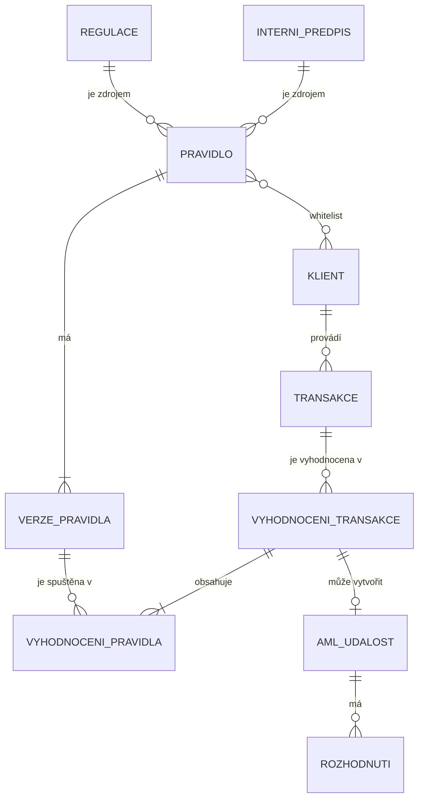

# Red-flag monitoring – high-level specifikace

- **Verze:** 0.1 (první návrh), 2026-10-19
- **Zdroj:** rozhovor týmu, [přepis](transcript/transcript.md) (citace ve formátu `P1 05:04` = část 1, čas 05:04)
- **Kontext challenge:** [knowledgebase/finreg/README.md](../knowledgebase/finreg/README.md)

## Jak číst tento dokument

Každý bod má jeden z typů:

- **Rozhodnutí** – tým se v rozhovoru shodl.
- **Návrh** – doplněno při sepisování, tým to zatím neschválil.
- **Otevřená otázka** – nerozhodnuto, viz [sekci 10](#10-otevřené-otázky).

Požadavky používají `musí`, `nesmí`, `měl by`, `může`.

## 1. Cíl

Systém vyhodnocuje platební transakce podle sady pravidel a vytváří AML události (red flags). Každou událost roztřídí, prioritizuje, eskaluje na správnou osobu a zapíše auditovatelný log. Pravidla vznikají z regulace nebo z interního předpisu. Pravidla verzuje a schvaluje člověk.

Hackathonová challenge pokrývá kroky Review → Escalate → Audit. Náš systém navíc řeší správu pravidel (vznik, verze, schválení).

## 2. Klíčová rozhodnutí

| # | Rozhodnutí | Zdroj |
| --- | --- | --- |
| D1 | Pravidlo vzniká z **regulace** (zákon) nebo z **interního předpisu** (custom). | P1 00:31 |
| D2 | Pravidla mají aspoň dva typy: **deterministické** (kód s jasným kontraktem vstupů a výstupů) a **agentní** (prompt pro LLM agenta nad dostupnými daty). | P1 01:30, 02:31 |
| D3 | Pravidlo vrací **skóre 0–100** a **trace** (log odůvodnění). Výstup true/false je možný až v budoucnu. | P1 03:20–03:48 |
| D4 | Vyhodnocení má dvě úrovně: **vyhodnocení transakce** (run pro jednu transakci v daném čase) obsahuje **vyhodnocení pravidel**. Každé vyhodnocení pravidla má vlastní kontext. | P1 07:19–07:49 |
| D5 | Každá transakce se v MVP vyhodnotí **jednou**. Batching a další optimalizace přijdou až po MVP. | P1 08:03 |
| D6 | Minimální kontext vyhodnocení tvoří **klient a celá jeho historie**. | P1 08:38, 09:51 |
| D7 | MVP pracuje v režimu **ex post** (zpětná detekce). Live prevention je směr do budoucna. | P1 10:19–11:26 |
| D8 | Pravidlo se ukládá jako **kód** a vedle něj **popis v lidském jazyce** (česky). Právník schvaluje popis, code review je volitelné. | P2 00:00–01:15 |
| D9 | Pravidlo má **verze**. Každá verze prochází schválením. Změna navázané regulace vyvolá novou verzi a nové review. | P2 01:41–01:52 |
| D10 | Pravidlo má **přepínač on/off**. Platnost od–do se v MVP neřeší. | P2 01:52 |
| D11 | Pravidlo má **whitelist klientů**, na které se nevztahuje. | P2 03:03–03:15 |
| D12 | Klient má **risk profil**, který může být i neznámý. Pravidlo nativně určuje, pro které risk profily platí. | P2 03:34–04:54 |
| D13 | **Citlivost** je v MVP globální koeficient, kterým se násobí skóre pravidla. | P2 05:49 |

## 3. Doménový model

| Entita | Popis | Klíčové atributy |
| --- | --- | --- |
| **Regulace** | Právní předpis (např. AML zákon, AMLR, seznamy EU/FATF). | název, odkaz na zdroj, platná verze |
| **Interní předpis** | Interní pravidlo instituce (custom). | název, text, vlastník |
| **Pravidlo** | Kontrola, která se spouští nad transakcí. Zdrojem je regulace nebo interní předpis. | typ (deterministické / agentní), zapnuto, platné risk profily, whitelist klientů, citlivost |
| **Verze pravidla** | Neměnný snapshot pravidla. | číslo verze, kód nebo prompt, lidský popis, stav, schválil, kdy |
| **Klient** | Klient instituce, data z client logu. | ID, země, typ, PEP, risk profil, AML risk score, projektované a historické objemy |
| **Transakce** | Platební transakce, data z transaction logu. | ID, klient, datum a čas, částka, měna, země plátce a příjemce, typ |
| **Vyhodnocení transakce** | Jeden run všech relevantních pravidel nad jednou transakcí v daném čase. | transakce, klient, čas runu, agregované skóre, odkazy na kontext |
| **Vyhodnocení pravidla** | Výsledek jedné verze pravidla v rámci vyhodnocení transakce. | verze pravidla, skóre 0–100, skóre po citlivosti, trace, použitý kontext |
| **AML událost** | Red flag k řešení, odpovídá řádku výstupního CSV. | typ, priorita, triage, odpovědná osoba, schvalovatel |
| **Rozhodnutí** | Záznam rozhodnutí o AML události (kdo, kdy, proč). | autor, čas, výsledek, odůvodnění |

Vazby:

- Transakci vždy provádí jeden klient. Metadata transakce mohou odkazovat na dalšího klienta, pokud je protistrana naším klientem (P1 04:35). **Návrh:** vyhodnocení transakce by mělo tento odkaz uložit jako kontext.
- **Návrh:** entity **AML událost** a **Rozhodnutí** doplňují model podle požadavků challenge (triage, priorita, eskalace, audit log). V rozhovoru byly zmíněny jen okrajově (P1 02:53).

## 4. Pravidla

### 4.1 Typy a kontrakt

- Deterministické pravidlo **musí** mít jasný kontrakt vstupů a výstupů. Implementace může být například JavaScript. Technologie zatím není rozhodnutá.
- Agentní pravidlo je prompt pro LLM agenta. Agent ho spouští nad daty, která má k dispozici. Jeho kontrakt je volnější. Výstup ale **musí** mít stejný tvar.
- **Návrh kontraktu:**
  - Vstup: transakce, klient, historie transakcí klienta, konfigurace pravidla.
  - Výstup: `score` (0–100), `trace` (strukturované odůvodnění: které podmínky se splnily a nad jakými daty), `context_refs` (odkazy na použitá data).
- Detekce podle pravidel A–C ze zadání **měla by** být deterministická. LLM má třídit, prioritizovat a odůvodňovat, ne procházet jednotlivé řádky dat. Odpovídá to doporučení FINREG.

### 4.2 Uložení, verze a schválení

- Verze pravidla **musí** obsahovat kód (nebo prompt) a vedle něj popis v češtině, který zkontroluje právník bez znalosti programování.
- Právník schvaluje popis. Uložený je i schválený popis, aby bylo jasné, co přesně schválil.
- Code review je v procesu **volitelný** krok. Každá instituce si ho může zapnout.
- Systém **nesmí** spustit verzi pravidla, která neprošla schválením.
- Když se změní regulace, systém **musí** u navázaných pravidel vyžádat novou verzi. Nová verze znovu prochází review.
- Když uživatel přidá novou regulaci, systém **může** podle ní navrhnout nové pravidlo (P1 01:30).
- **Návrh stavů verze:** `draft` → `for_review` → `approved` → `live` → `superseded`. Dashboard ukazuje minimálně stavy `live` a `for_review` (P2 03:19).

### 4.3 Konfigurace pravidla

| Nastavení | Chování | Stav |
| --- | --- | --- |
| Zapnuto / vypnuto | Vypnuté pravidlo se nespouští. Datum platnosti se v MVP neřeší. | Rozhodnutí |
| Whitelist klientů | Pravidlo se nespouští pro vyjmenované klienty. | Rozhodnutí |
| Platné risk profily | Pravidlo se spouští jen pro klienty s uvedeným risk profilem (např. `high`, `low`, `unknown`). | Rozhodnutí |
| Citlivost | `skóre_po_citlivosti = min(100, skóre × citlivost)`. MVP: jeden globální koeficient. | Rozhodnutí (rozsah otevřený) |
| Citlivost per pravidlo nebo per risk profil | Jemnější nastavení citlivosti. | Mimo MVP |

## 5. Vyhodnocení

- Vyhodnocovací run zpracuje transakci jednou. Spustí všechna pravidla, která jsou zapnutá, schválená a platná pro risk profil klienta a z jejichž whitelistu klient není vyjmutý.
- Každé vyhodnocení pravidla **musí** uložit vlastní kontext a trace. Compliance officer musí v detailu vidět, která pravidla prošla, která ne a s jakým skóre (P1 05:04, 06:49).
- Při 100 transakcích a 10 pravidlech vznikne 100 vyhodnocení transakce a 1 000 vyhodnocení pravidel.
- Systém **musí** zvládnout projít celý dataset challenge (~400 000 transakcí za červenec 2026).
- **Návrh:** AML událost vznikne, když agregované skóre vyhodnocení transakce překročí práh. LLM ji pak roztřídí (`FP` / `REVIEW`), přidělí prioritu 0–100 a odůvodní.

### 5.1 Režimy

| Režim | Popis | Stav |
| --- | --- | --- |
| Ex post (batch) | Zpětná detekce nad historickými daty. Je to oborový standard. | MVP |
| Live prevention | Transakce se vyhodnotí před provedením a výsledek je schválit / zamítnout. | Po MVP |

## 6. Mapování na výstup challenge

Povinné CSV obsahuje jeden řádek na AML událost. Viz [knowledgebase](../knowledgebase/finreg/README.md#output-and-deliverables).

| Sloupec CSV | Zdroj v našem modelu | Stav |
| --- | --- | --- |
| `alert_id`, `alert_type`, `client_id`, `transaction_id` | AML událost + pravidlo | Návrh |
| `triage` (`FP`/`REVIEW`) | LLM nad vyhodnocením transakce | Návrh |
| `priority` (0–100) | Skóre po citlivosti + rizikové faktory klienta | Návrh |
| `executive_role`, `executive_person`, `approver` | Eskalační matice + pravidla střetu zájmů | Neřešeno v rozhovoru |
| `reason`, `log` | Trace vyhodnocení pravidel + Rozhodnutí | Návrh |

## 7. Uživatelské rozhraní

- Dashboard **musí** mít sekci **Pravidla**: seznam pravidel se stavem (`live`, `for_review`), přepínačem on/off a odkazem na zdrojovou regulaci nebo předpis.
- Detail verze pravidla **musí** ukázat kód a lidský popis vedle sebe a umožnit schválení.
- Detail vyhodnocení **musí** ukázat transakci, klienta, jeho historii, výsledky všech pravidel se skóre a trace. **Návrh:** stejný detail slouží jako podklad pro rozhodnutí o AML události.

## 8. Nefunkční požadavky

- Stack: AWS, primárně Amazon Bedrock (viz [AGENTS.md](../AGENTS.md)).
- Audit: každé vyhodnocení, změna pravidla, schválení a rozhodnutí **musí** mít záznam: kdo, kdy, co, proč a jaká verze pravidla.
- Data nesmí opustit hackathon prostředí bez schválení člověkem.
- Výkon není v MVP omezení (P1 11:26). Celý dataset ale musí doběhnout v rozumném čase pro demo.

## 9. Mimo rozsah MVP

- Live prevention mód.
- Batching nebo inkrementální vyhodnocení (např. jednou za hodinu per klient).
- Časová platnost pravidel (datum od–do).
- Citlivost per pravidlo nebo per risk profil.
- Výstup pravidla jiný než skóre 0–100.

## 10. Otevřené otázky

1. **Granularita AML události.** Zadání požaduje u pravidel A a C jednu událost na klienta, u pravidla B jednu na transakci. Náš model vyhodnocuje per transakce. Jak se vyhodnocení transakcí agregují do událostí per klient?
2. **Vyhodnocení per transakce, nebo per klient.** Rozhovor se přiklonil k per transakce (P1 09:13–09:51). Varianta „vyhodnocení klienta v daném čase“ zůstala otevřená.
3. **Agregace skóre.** Jak se ze skóre jednotlivých pravidel spočítá skóre vyhodnocení transakce (max, vážený součet…) a jaký je práh pro vznik AML události?
4. **Rozsah citlivosti.** Jen 0–1 (pouze snižuje), nebo i > 1 (zvyšuje)? (P2 05:49)
5. **Risk profil v pravidle.** Nativní vazba (rozhodnutí D12), nebo podmínka uvnitř logiky pravidla? Je potřeba ověřit, že to pokrývá všechny případy.
6. **Technologie deterministických pravidel.** JavaScript, Python, nebo DSL? Kde a jak se kód spouští (sandbox)?
7. **Eskalace a střet zájmů.** Eskalační matice a pravidla střetu zájmů jsou ve zdroji, který zatím nemáme (20 % hodnocení). V rozhovoru se neřešily.
8. **Generování pravidel z regulace.** Jak přesně LLM navrhne pravidlo z nové regulace a kdo navrženou verzi zakládá?
9. **Otevřené otázky k datům** z [knowledgebase](../knowledgebase/finreg/README.md#open-questions-for-our-implementation): FX kurzy, směr transakce, okna pravidla C, verze seznamů vysoce rizikových zemí.

## 11. Compliance poznámky

Body níže **musí** před reálným nasazením zkontrolovat compliance officer nebo právník:

- **Whitelist klientů** a **omezení pravidel na risk profil** potlačují detekci. Každé přidání do whitelistu by mělo projít schválením, mít odůvodnění a záznam v audit logu. Je potřeba ověřit, zda je výjimka u regulatorně povinných pravidel (např. vysoce rizikové země, PEP) vůbec přípustná.
- **Citlivost < 1** snižuje skóre všech pravidel. Změna globální citlivosti by měla být schvalovaná a logovaná stejně jako změna pravidla.
- **Automatické `FP`** je rozhodnutí bez člověka. Výstup systému je podklad pro rozhodnutí, ne finální AML určení.
- **Schválení pravidla právníkem** podle lidského popisu předpokládá, že kód popisu odpovídá. Systém by měl tuto shodu ověřovat (testy, review, LLM kontrola).
