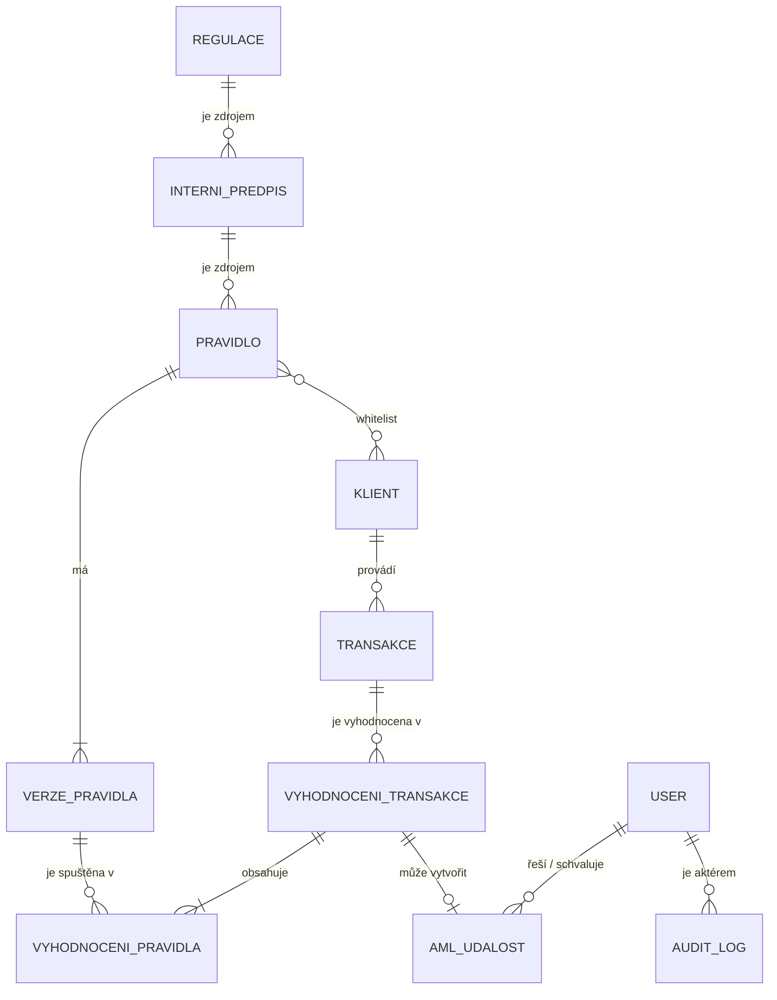

# Red-flag monitoring – high-level specifikace

- **Verze:** 0.3, 2026-10-19
- **Zdroje:**
  - `P1`, `P2`: rozhovor týmu, [přepis](transcript/transcript.md). Citace `P1 05:04` znamená část 1, čas 05:04.
  - `N`: Notion stránka [RedFlag tool spec](https://app.notion.com/p/3fe931fc277e8059bc51c2d5894ecbf3) (stav k 2026-10-19 13:53). Odkazovaný Miro board s architekturou je privátní a není zde zapracovaný.
- **Kontext challenge:** [knowledgebase/finreg/README.md](../knowledgebase/finreg/README.md)

## Jak číst tento dokument

Každý bod má jeden z typů:

- **Rozhodnutí**: tým se shodl v rozhovoru nebo v Notionu.
- **Návrh**: doplněno při sepisování, tým to zatím neschválil.
- **Otevřená otázka**: nerozhodnuto, viz [sekci 10](#10-otevřené-otázky).

Požadavky používají `musí`, `nesmí`, `měl by`, `může`.

## 1. Cíl

Systém vyhodnocuje platební transakce podle sady pravidel a vytváří AML události (red flags). Každou událost roztřídí, prioritizuje, eskaluje na správnou osobu a zapíše do auditovatelného logu.

Pravidla vznikají z interních předpisů, které vycházejí z regulací. Uživatel je může nechat vygenerovat průvodcem (wizardem) ze seznamu regulací, nebo je vytvořit ručně. Každé pravidlo schvaluje člověk.

Hackathonová challenge pokrývá kroky Review → Escalate → Audit. Náš systém navíc řeší správu pravidel: jejich vznik, verze, schválení a aktualizaci při změně regulace.

## 2. Klíčová rozhodnutí

| # | Rozhodnutí | Zdroj |
| --- | --- | --- |
| D1 | Hierarchie: **regulace → interní předpis → pravidlo**. Předpis a regulace mají vazbu M:N. Pravidlo má nepovinný FK na předpis (viz [M3, M4](datovy-model-pravidla.md#rozhodnutí)). | N; upřesňuje P1 00:31 |
| D2 | Pravidla mají dva typy: **deterministické** (kód s jasným kontraktem vstupů a výstupů) a **agentní** (text pravidla, který vyhodnocuje LLM agent nad dostupnými daty). | P1 01:30, 02:31; N |
| D3 | Pravidlo vrací **skóre 0–100** a **trace** (log odůvodnění). Výstup true/false je možný až v budoucnu. | P1 03:20–03:48 |
| D4 | Vyhodnocení má dvě úrovně: **vyhodnocení transakce** obsahuje 1:N **vyhodnocení pravidel**. Vyhodnocení transakce je jeden run nad transakcí v daném čase. Každé vyhodnocení pravidla má vlastní kontext. | P1 07:19–07:49; N |
| D5 | Každá transakce se v MVP vyhodnotí **jednou**. Batching a optimalizace přijdou až po MVP. | P1 08:03 |
| D6 | Minimální kontext vyhodnocení tvoří **klient a celá jeho historie**. | P1 08:38, 09:51 |
| D7 | MVP pracuje v režimu **ex post** (zpětná detekce). Live prevention je směr do budoucna. | P1 10:19–11:26 |
| D8 | Deterministické pravidlo se ukládá jako **kód** a vedle něj **lidský přepis** v češtině. Právník schvaluje lidský přepis. Code review je volitelné. | P2 00:00–01:15; N |
| D9 | Pravidlo má **verze**. Změna navázané regulace vyvolá novou verzi a nové review. | P2 01:41–01:52; N |
| D10 | Pravidlo má **stav**: `draft`, `pending_for_review`, `update_for_review`, `active`, `inactive`. Přepínač on/off odpovídá stavům `active` a `inactive`. Platnost od–do se v MVP neřeší. | N; P2 01:52 |
| D11 | Pravidlo má **whitelist klientů**, na které se nevztahuje. | P2 03:03–03:15 |
| D12 | Klient má **risk profil**, který může být i neznámý. Pravidlo nativně určuje, pro které risk profily platí. | P2 03:34–04:54 |
| D13 | **Citlivost** je nastavení **každého pravidla** na škále **0–100**. Nahrazuje původní návrh globálního koeficientu z rozhovoru. | N; mění P2 05:49 |
| D14 | Pravidla se zakládají **wizardem** (ze seznamu regulací) nebo **ručně**. V MVP uživatel zadá do wizardu přímo text regulace. | N |
| D15 | Systém eviduje **interní uživatele s rolemi** a vede **audit log**. | N |
| D16 | Vyhodnocení v MVP je **PoC run**, který uživatel spustí ručně z dashboardu. Spustí všechna pravidla. | N |
| D17 | **Zpracování AML událostí** (schvalovací proces) je v MVP **nice-to-have**. | N |

## 3. Doménový model

Podrobný model regulací, interních předpisů a pravidel je v [datovy-model-pravidla.md](datovy-model-pravidla.md). Tam uvedená rozhodnutí M1–M17 mají přednost před touto sekcí.

| Entita | Popis | Klíčové atributy |
| --- | --- | --- |
| **Regulace** | Právní předpis, např. AML zákon, AMLR nebo seznamy EU/FATF. | název, odkaz na zdroj, platná verze, datum poslední kontroly aktualizace |
| **Interní předpis** | Interní pravidlo instituce. Typicky vychází z regulace. | FK regulace, název, text, stav (draft / schválený) |
| **Pravidlo** | Kontrola, která se spouští nad transakcí. | FK předpis, typ (deterministické / agentní), stav, platné risk profily, whitelist klientů, citlivost 0–100 |
| **Verze pravidla** | Neměnný snapshot pravidla. | číslo verze, text pravidla (agentní) nebo kód + lidský přepis (deterministické), schválil, kdy |
| **Klient** | Klient instituce, data z client logu. | ID, země, typ, PEP, risk profil, AML risk score, projektované a historické objemy |
| **Transakce** | Platební transakce, data z transaction logu. | ID, klient, datum a čas, částka, měna, země plátce a příjemce, typ |
| **Vyhodnocení transakce** | Jeden run všech relevantních pravidel nad jednou transakcí v daném čase. | transakce, klient, čas runu, agregované skóre, odkazy na kontext |
| **Vyhodnocení pravidla** | Výsledek jedné verze pravidla v rámci vyhodnocení transakce. | verze pravidla, skóre 0–100, skóre po citlivosti, trace, použitý kontext |
| **AML událost** | Red flag k řešení. Odpovídá řádku výstupního CSV. | typ, priorita, triage, odpovědná osoba (user), schvalovatel (user), stav |
| **User (interní)** | Zaměstnanec instituce, např. AML analytik, compliance officer, právník nebo vedoucí. | jméno, role, přiřazení klienti (kvůli střetu zájmů) |
| **Audit log** | Neměnný záznam každé akce: kdo, kdy, co, proč. | aktér (user / systém / agent), akce, cílová entita, odůvodnění, čas |

Vazby a upřesnění:

- Transakci vždy provádí jeden klient. Metadata transakce mohou odkazovat na dalšího klienta, pokud je protistrana naším klientem (P1 04:35). **Návrh:** vyhodnocení transakce tento odkaz uloží jako kontext.
- **Návrh:** rozhodnutí o AML události (dříve samostatná entita Rozhodnutí) se zapisuje do audit logu. AML událost drží jen aktuální stav.
- **Návrh:** atribut User „přiřazení klienti“ slouží k pravidlu „nikdo nereviduje vlastní klienty ani vlastní rozhodnutí“ (FINREG, slide 05).

## 4. Pravidla

### 4.1 Typy a kontrakt

- Deterministické pravidlo **musí** mít jasný kontrakt vstupů a výstupů. Implementace může být například JavaScript. Technologie zatím není rozhodnutá.
- Agentní pravidlo je **text pravidla** v přirozeném jazyce. LLM agent ho vyhodnocuje nad daty, která má k dispozici. Výstup **musí** mít stejný tvar jako u deterministického pravidla.
- **Návrh kontraktu:**
  - Vstup: transakce, klient, historie transakcí klienta, konfigurace pravidla.
  - Výstup: `score` (0–100), `trace` (strukturované odůvodnění: které podmínky se splnily a nad jakými daty), `context_refs` (odkazy na použitá data).
- Detekce podle pravidel A–C ze zadání **měla by** být deterministická. LLM má třídit, prioritizovat a odůvodňovat, ne procházet jednotlivé řádky dat. Odpovídá to doporučení FINREG.

### 4.2 Vznik pravidel

**Wizard (předpisy → pravidla)** (N):

1. Uživatel zadá seznam regulací, které musí instituce splňovat. V MVP zadá přímo text regulace (bez stahování ze zdroje).
2. Systém zavolá API a vytvoří draft interního předpisu.
3. Systém zavolá API a z předpisu vytvoří sadu pravidel ve stavu `draft`.
4. Pravidla jdou ke schválení. Reviewer vidí vedle sebe kód pravidla a jeho lidský přepis.

**Ruční tvorba** (N): uživatel zadá popis pravidla, odkaz na regulaci nebo předpis, whitelist klientů, citlivost a risk profily, pro které se pravidlo spouští. Systém z popisu vygeneruje kód (deterministické) nebo text (agentní) a pravidlo jde ke schválení.

- **Návrh:** generování předpisů a pravidel běží přes Amazon Bedrock. Každý vygenerovaný artefakt **musí** odkazovat na konkrétní ustanovení zdrojové regulace, aby šel ověřit.

### 4.3 Stavy, verze a schválení

| Stav | Význam |
| --- | --- |
| `draft` | Rozpracované nebo vygenerované pravidlo. Nespouští se. |
| `pending_for_review` | Nové pravidlo čeká na schválení. Nespouští se. |
| `update_for_review` | Existující pravidlo má navrženou novou verzi, která čeká na schválení. **Návrh:** dosavadní schválená verze se dál spouští. |
| `active` | Schválené a zapnuté. Spouští se. |
| `inactive` | Vypnuté. Nespouští se. |

- Verze pravidla **musí** obsahovat kód a lidský přepis v češtině (deterministické), nebo text pravidla (agentní). Lidskému přepisu musí rozumět právník bez znalosti programování.
- Uložený zůstává i schválený lidský přepis, aby bylo jasné, co přesně právník schválil.
- Code review je **volitelný** krok procesu. Každá instituce si ho může zapnout.
- Systém **nesmí** spustit verzi pravidla, která neprošla schválením.
- **Aktualizace regulací** (N): tlačítko na dashboardu projde seznam regulací a zjistí, zda mají aktualizaci. Pro dotčená pravidla navrhne nové verze ve stavu `update_for_review`.
- **Nová regulace** (N): uživatel přidá regulaci ke splnění a systém vytvoří sadu pravidel stejně jako wizard.

### 4.4 Konfigurace pravidla

| Nastavení | Chování | Stav |
| --- | --- | --- |
| Stav `active` / `inactive` | Vypnuté pravidlo se nespouští. Datum platnosti se v MVP neřeší. | Rozhodnutí |
| Whitelist klientů | Pravidlo se nespouští pro vyjmenované klienty. | Rozhodnutí |
| Platné risk profily | Pravidlo se spouští jen pro klienty s uvedeným risk profilem (např. `high`, `low`, `unknown`). | Rozhodnutí |
| Citlivost | Každé pravidlo má citlivost 0–100. **Návrh výpočtu:** `skóre_po_citlivosti = skóre × citlivost / 100`, tedy citlivost skóre jen snižuje nebo nechá stejné. | Rozhodnutí (výpočet otevřený) |
| Citlivost per risk profil | Jiná citlivost pro různé risk profily klienta. | Mimo MVP |

## 5. Vyhodnocení

- V MVP uživatel spouští vyhodnocovací run ručně z dashboardu (PoC vyhodnocení, N). Run zpracuje transakci jednou. Spustí všechna pravidla ve stavu `active` (případně jejich poslední schválenou verzi), která platí pro risk profil klienta a z jejichž whitelistu klient není vyjmutý.
- Každé vyhodnocení pravidla **musí** uložit vlastní kontext a trace. Compliance officer musí v detailu vidět, která pravidla prošla, která ne a s jakým skóre (P1 05:04, 06:49).
- Příklad: 100 transakcí a 10 pravidel dá 100 vyhodnocení transakce a 1 000 vyhodnocení pravidel.
- Systém **musí** zvládnout projít celý dataset challenge (~400 000 transakcí za červenec 2026).
- **Návrh:** AML událost vznikne, když agregované skóre vyhodnocení transakce překročí práh. LLM ji pak roztřídí (`FP` / `REVIEW`), přidělí prioritu 0–100 a odůvodní. Podle eskalační matice a rolí uživatelů ji přiřadí odpovědné osobě a schvalovateli.

### 5.1 Režimy

| Režim | Popis | Stav |
| --- | --- | --- |
| Ex post (batch) | Zpětná detekce nad historickými daty. Je to oborový standard. | MVP |
| Live prevention | Transakce se vyhodnotí před provedením a výsledek je schválit / zamítnout. | Po MVP |

## 6. Mapování na výstup challenge

Povinné CSV obsahuje jeden řádek na AML událost. Viz [knowledgebase](../knowledgebase/finreg/README.md#output-and-deliverables).

| Sloupec CSV | Zdroj v našem modelu | Stav |
| --- | --- | --- |
| `alert_id`, `alert_type`, `client_id`, `transaction_id` | AML událost + pravidlo | Návrh |
| `triage` (`FP`/`REVIEW`) | LLM nad vyhodnocením transakce | Návrh |
| `priority` (0–100) | Skóre po citlivosti + rizikové faktory klienta | Návrh |
| `executive_role`, `executive_person`, `approver` | User a role + eskalační matice + pravidla střetu zájmů | Návrh (matice chybí; zpracování událostí je v N jen nice-to-have) |
| `reason`, `log` | Trace vyhodnocení pravidel + audit log | Návrh |

## 7. Uživatelské rozhraní

Zdroj sekce je Notion (N), pokud bod nemá jiný typ.

### 7.1 Dashboard

Dashboard je vstupní obrazovka. **Musí** obsahovat:

- vstup do wizardu ([7.2](#72-wizard-předpisy--pravidla)),
- výpis pravidel ([7.3](#73-pravidla)),
- správu regulací ([7.4](#74-regulace)),
- PoC vyhodnocení ([7.5](#75-poc-vyhodnocení)),
- audit log ([7.7](#77-audit-log)).

### 7.2 Wizard (předpisy → pravidla)

Postup viz [4.2](#42-vznik-pravidel).

1. **Zadání regulací.** Uživatel zadá seznam regulací, které instituce musí splňovat. V MVP vloží přímo text regulace.
2. **Draft předpisu.** Systém zavolá API a zobrazí vygenerovaný draft interního předpisu.
3. **Sada pravidel.** Systém zavolá API a zobrazí vygenerovaná pravidla.
4. **Schválení.** U každého pravidla jsou vedle sebe kód pravidla a lidský přepis. Uživatel pravidlo schválí, nebo zamítne.

- **Návrh:** uživatel může draft předpisu před krokem 3 upravit.
- **Návrh:** u každého vygenerovaného předpisu a pravidla je odkaz na ustanovení zdrojové regulace.

### 7.3 Pravidla

**Výpis pravidel:**

- seznam pravidel se stavem (`draft`, `pending_for_review`, `update_for_review`, `active`, `inactive`),
- tlačítko pro vytvoření nového pravidla,
- **Návrh:** u pravidla odkaz na zdrojový předpis a regulaci a filtr podle stavu.

**Ruční tvorba pravidla** (formulář):

| Pole | Popis |
| --- | --- |
| Popis pravidla | Text v přirozeném jazyce. Systém z něj vygeneruje kód (deterministické) nebo text (agentní). |
| Zdroj | Odkaz na regulaci nebo interní předpis. Viz [otázku 3](#10-otevřené-otázky). |
| Whitelist klientů | Klienti, pro které se pravidlo nespouští. |
| Citlivost | Hodnota 0–100. |
| Risk profily | Rizikové kategorie klienta, pro které se pravidlo spouští. |

Po uložení jde pravidlo do stavu `pending_for_review`.

**Návrh – detail pravidla:**

- kód a lidský přepis vedle sebe,
- akce schválit / zamítnout / zapnout / vypnout,
- historie verzí a u každé verze, kdo ji schválil a kdy,
- proklik na předpis a regulaci.

### 7.4 Regulace

- **Zkontrolovat aktualizace:** tlačítko projde seznam regulací a zjistí, zda mají aktualizaci. Pro dotčená pravidla navrhne nové verze ve stavu `update_for_review`. Viz [otázku 10](#10-otevřené-otázky).
- **Přidat regulaci:** uživatel přidá novou regulaci ke splnění. Systém vytvoří sadu pravidel stejně jako wizard.

### 7.5 PoC vyhodnocení

1. Uživatel ručně spustí run vyhodnocení všech pravidel.
2. Systém zobrazí výsledky vyhodnocení.
3. U transakcí, které pravidly neprojdou, systém zobrazí AML události.
4. Ke každé AML události systém zobrazí celý potřebný kontext: transakci, klienta, jeho historii a výsledky všech pravidel se skóre a trace.

- **Návrh:** během runu systém zobrazí průběh (počet zpracovaných transakcí), protože celý dataset má ~400 000 transakcí.
- **Návrh:** výsledky jde exportovat do povinného CSV ([sekce 6](#6-mapování-na-výstup-challenge)).

### 7.6 Zpracování AML událostí (nice-to-have)

- Schvalovací proces AML události: triage, přiřazení odpovědné osobě a schvalovateli, rozhodnutí.
- **Návrh:** fronta událostí přiřazených přihlášenému uživateli, seřazená podle priority.
- **Návrh:** UI nedovolí uživateli rozhodnout o vlastním klientovi ani schválit vlastní rozhodnutí (střet zájmů).

### 7.7 Audit log

- Záznam všech vyhodnocení.
- U každého vyhodnocení: která pravidla prošla, která ne a v jaké verzi.
- Z pravidla jde prokliknout na interní předpis a z předpisu na regulaci.
- **Návrh:** audit log zobrazí i změny pravidel, schválení a rozhodnutí o AML událostech ([sekce 8](#8-nefunkční-požadavky)).

## 8. Nefunkční požadavky

- Stack: AWS, primárně Amazon Bedrock (viz [AGENTS.md](../AGENTS.md)).
- Audit: každé vyhodnocení, změna pravidla, schválení a rozhodnutí **musí** mít záznam v audit logu: kdo, kdy, co, proč a jaká verze pravidla.
- Data nesmí opustit hackathon prostředí bez schválení člověkem.
- Výkon není v MVP omezení (P1 11:26). Celý dataset ale musí doběhnout v čase použitelném pro demo.

## 9. Mimo rozsah MVP (out of scope)

- Live prevention mód.
- Batching nebo inkrementální vyhodnocení (např. jednou za hodinu per klient).
- Stahování regulací z webu (scraping) (N). V MVP uživatel zadává text regulace ručně.
- Optimalizace nákladů (N).
- Caching chování per uživatel nebo entita (N).
- Časová platnost pravidel (datum od–do).
- Citlivost per risk profil.
- Výstup pravidla jiný než skóre 0–100.
- Konvertování a zpracování PDF regulací na vstupu
- Monitoring metodických pokynů ČNB ke konkrétním hackům/incidentům -> vytvoříme pravidlo, zkontrolujeme

## 10. Otevřené otázky

1. **MVP scope.** Sekce v Notionu je prázdná. Jako nice-to-have je zatím označené jen zpracování AML událostí. Které z ostatních částí (wizard, ruční tvorba, aktualizace regulací, PoC vyhodnocení, audit log) jsou nutné pro demo?
2. ~~**FK předpis → regulace.**~~ Vyřešeno: vazba M:N, nepovinná ([M3](datovy-model-pravidla.md#rozhodnutí)).
3. ~~**Ruční pravidlo s odkazem na regulaci.**~~ Vyřešeno: FK na předpis je nepovinný, právní základ má každá verze pravidla ([M4, M5](datovy-model-pravidla.md#rozhodnutí)).
4. ~~**Verze vs. stav.**~~ Vyřešeno: `update_for_review` je odvozený stav, mezitím se spouští aktivní verze ([M6](datovy-model-pravidla.md#rozhodnutí)).
5. **Granularita AML události.** Zadání požaduje u pravidel A a C jednu událost na klienta, u pravidla B jednu na transakci. Náš model vyhodnocuje per transakce. Jak se vyhodnocení transakcí agregují do událostí per klient?
6. **Vyhodnocení per transakce, nebo per klient.** Rozhovor se přiklonil k per transakce (P1 09:13–09:51). Varianta „vyhodnocení klienta v daném čase“ zůstala otevřená.
7. **Agregace skóre.** Jak se ze skóre pravidel spočítá skóre vyhodnocení transakce (max, vážený součet…) a jaký je práh pro vznik AML události?
8. **Výpočet citlivosti.** Citlivost je 0–100 per pravidlo (N). Jak přesně mění skóre? Návrh `skóre × citlivost / 100` skóre jen snižuje. Má jít skóre i zvýšit (P2 05:49)? Zůstává vedle toho globální koeficient z rozhovoru?
9. **Technologie deterministických pravidel.** JavaScript, Python, nebo DSL? Kde a jak se kód spouští (sandbox)?
10. **Kontrola aktualizací regulací.** V MVP se regulace zadává jako text a scraping je mimo rozsah. Jak tedy tlačítko „zkontrolovat aktualizace“ zjistí novou verzi? Uživatel vloží nový text, nebo systém použije zdroj (EUR-Lex, e-Sbírka, seznamy FATF)?
11. **Eskalace a střet zájmů.** Eskalační matice a pravidla střetu zájmů zatím nemáme. Zpracování událostí je v Notionu jen nice-to-have, ale challenge za eskalaci dává 20 % hodnocení. Jaké role musí mít entita User?
12. **Architektura.** Miro board z Notionu je privátní. Je potřeba ho zpřístupnit nebo převést do repa.
13. **Otevřené otázky k datům** z [knowledgebase](../knowledgebase/finreg/README.md#open-questions-for-our-implementation): FX kurzy, směr transakce, okna pravidla C, verze seznamů vysoce rizikových zemí.

## 11. Compliance poznámky

Body níže **musí** před reálným nasazením zkontrolovat compliance officer nebo právník:

- **Whitelist klientů** a **omezení pravidel na risk profil** potlačují detekci. Každé přidání do whitelistu by mělo projít schválením, mít odůvodnění a záznam v audit logu. Je potřeba ověřit, zda je výjimka u regulatorně povinných pravidel (např. vysoce rizikové země, PEP) vůbec přípustná.
- **Nízká citlivost** snižuje skóre pravidla a může potlačit detekci. Změna citlivosti by měla být schvalovaná a logovaná stejně jako změna pravidla (nová verze).
- **Generované předpisy a pravidla** (wizard, aktualizace regulací) jsou návrhy LLM. Nesmí se aktivovat bez lidského schválení. Interní předpis jako dokument (AML zákon § 21) musí schválit odpovědná osoba instituce.
- **Automatické `FP`** je rozhodnutí bez člověka. Výstup systému je podklad pro rozhodnutí, ne finální AML určení.
- **Schválení pravidla právníkem** podle lidského přepisu předpokládá, že kód přepisu odpovídá. Systém by měl tuto shodu ověřovat (testy, review, LLM kontrola).
